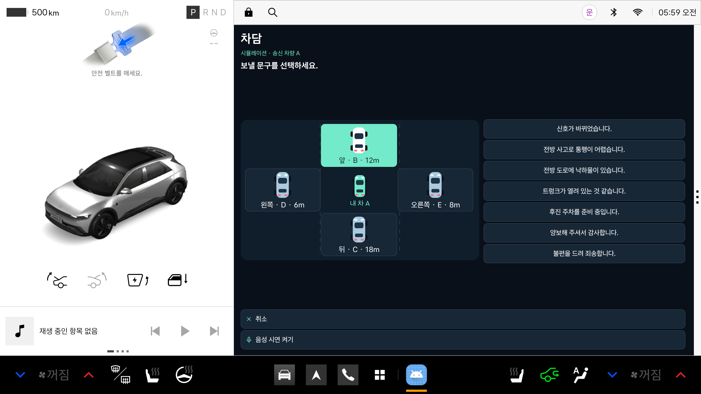
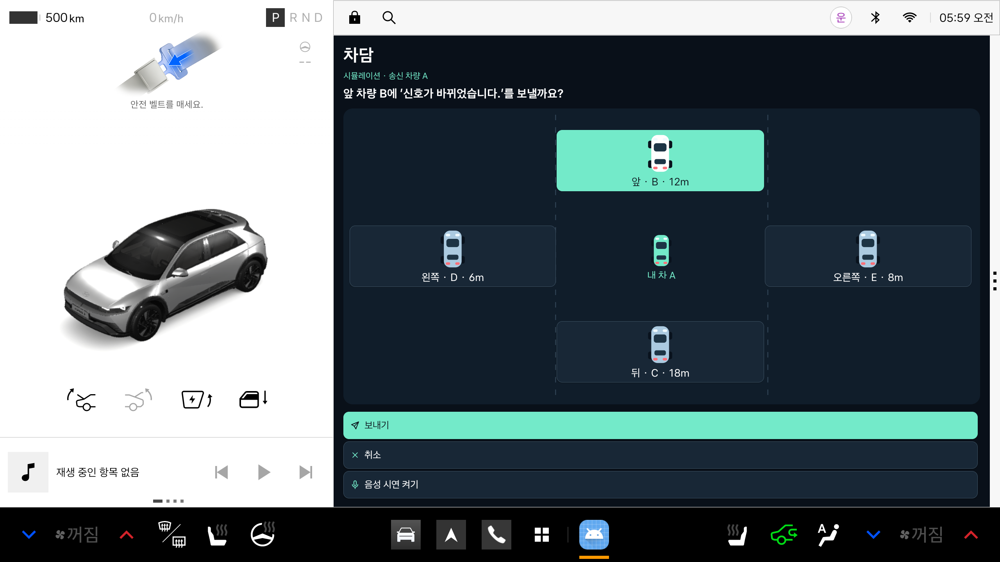
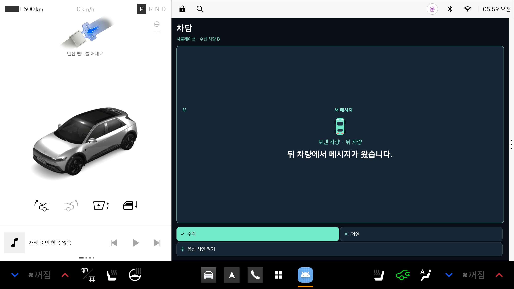
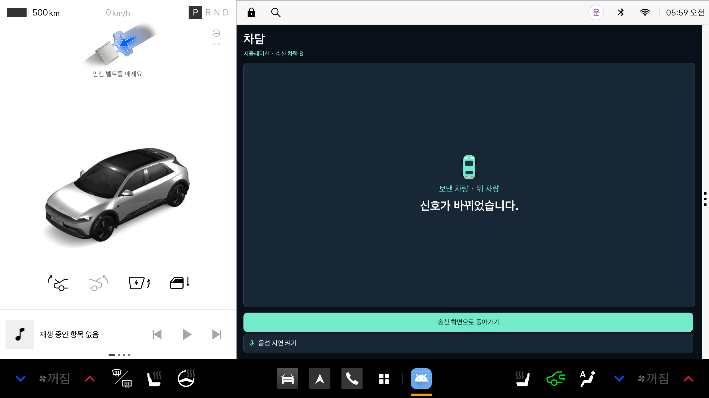

# 차담

**차담은 주변 차량을 선택해 정해진 메시지를 보내는 Pleos Connect 차량용 앱입니다.**

차량 화면에서 앞·뒤·왼쪽·오른쪽의 가상 차량을 고르고, “신호가 바뀌었습니다”처럼 미리 정해진 문구를 보냅니다. 받는 차량에는 자신을 기준으로 보낸 차량의 방향이 표시되며, 수락하면 메시지를 확인할 수 있습니다.

## 시연 영상

[차담 버튼 시연 영상 보기 (MP4, 약 35초)](docs/chadam-demo.mp4)

앞 차량 선택 → 신호 변경 안내 전송 → 발신 방향이 표시된 새 메시지 알림 → 수락 후 문구 확인을 담았습니다. 영상은 무음이며 버튼으로 조작합니다.

## 시연 화면

| 주변 차량 선택 | 대상과 문구 확인 |
| --- | --- |
|  |  |

| 수신 알림 | 수락 후 메시지 |
| --- | --- |
|  |  |

## APK 다운로드

[차담 디버그 APK](apk/chadam-debug.apk)를 다운로드할 수 있습니다. 저장소 내 파일 경로는 `apk/chadam-debug.apk`입니다.

## 테스트 환경과 설정

| 항목 | 테스트 환경 |
| --- | --- |
| 개발 OS | Windows |
| Pleos Connect 에뮬레이터 | **v2.1.0**, Android API 34, x86_64 |
| 화면 규격 | **2560 × 1440 px**, 가로 16:9, 160 dpi |
| 빌드 환경 | Android SDK Platform 34, Gradle Wrapper 8.9, 검증에 사용한 JDK 21 |

버튼 시연은 테스트 데이터로 동작합니다. 음성 시연을 별도로 시험하려면 에뮬레이터의 **Extended Controls → Microphone → Virtual microphone uses host audio input**을 켜고, 차담에 마이크 권한을 허용합니다. 한국어 인식은 에뮬레이터의 음성 서비스에 의존하며, 제출 시연에서 확인한 범위는 버튼 송수신입니다.

## 실행 방법

완성 APK로 실행하려면 Pleos 에뮬레이터를 켠 뒤 저장소 루트에서 다음 명령을 실행하고 앱 목록에서 **차담**을 엽니다. `adb`는 Android SDK의 `platform-tools`에 있습니다.

```powershell
adb install -r apk/chadam-debug.apk
```

소스에서 실행하려면 다음 순서로 설정합니다.

1. Android Studio에서 이 저장소의 루트 폴더를 엽니다.
2. Gradle JDK를 **17 또는 21**로 지정하고 SDK Manager에서 **Android SDK Platform 34**를 설치합니다.
3. [Pleos Connect 에뮬레이터 설치 안내](https://document.pleos.ai/docs/connect/guide/getting-started/application-development/setup-connect-sdk-emulator)에 따라 에뮬레이터를 설정합니다.
4. 실행 대상으로 Pleos Connect 에뮬레이터를 선택하고 Android Studio에서 **Run app**을 누릅니다. 버튼 시연은 API 28 이상의 일반 Android 에뮬레이터에서도 실행할 수 있습니다.

PowerShell에서 디버그 APK를 빌드하려면 호환 JDK와 Android SDK를 설정한 상태에서 실행합니다.

```powershell
.\gradlew.bat assembleDebug
```

APK는 `app/build/outputs/apk/debug/app-debug.apk`에 생성됩니다.

## 사용 방법

1. **메시지 보내기**를 누르고 화면에서 **앞 차량** 모양을 선택합니다.
2. **신호가 바뀌었습니다.**를 선택하고 대상과 문구를 확인한 뒤 **보내기**를 누릅니다.
3. 가상 수신 화면에서 **뒤 차량에서 메시지가 왔습니다**라는 안내가 표시됩니다. **수락**하면 문구가 공개되고, **거절**하거나 20초 동안 응답하지 않으면 종료됩니다.

음성을 시험하려면 **음성 시연 켜기**를 누르고 마이크 권한을 허용합니다. 앱 화면에서 “메시지 전송 → 앞 차량 → 신호 바뀜 → 보내 → 확인”을 한 단계씩 말합니다. 이 모드에는 에뮬레이터의 PC 마이크 입력과 Android 한국어 음성 인식 서비스가 필요합니다. 한국어 음성 합성이 지원되면 앱이 안내 문구를 읽어줍니다.

## 구현 범위

- **환경** — Kotlin, Android 기본 View, Gradle Wrapper, Pleos Connect 에뮬레이터
- **시뮬레이션** — 한 앱 세션에서 가상 차량 목록과 송신·수신 화면을 처리합니다. 발신 방향은 시연 차량들이 같은 진행 방향을 바라보는 조건에서 계산합니다.
- **검증** — Pleos 에뮬레이터에서 버튼으로 차량 선택, 전송, 발신 방향 표시, 수락 후 문구 표시를 확인했습니다.
- **후속 개발** — 실차 ADAS 추적과 수신 차량 매칭, 차량 간 통신, 긴급차량 접근 알림, 차량 상태 제보용 사진 첨부를 검토합니다.
